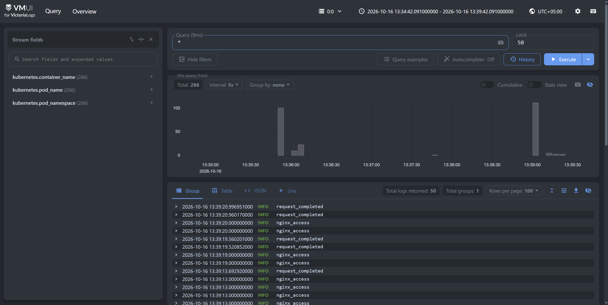
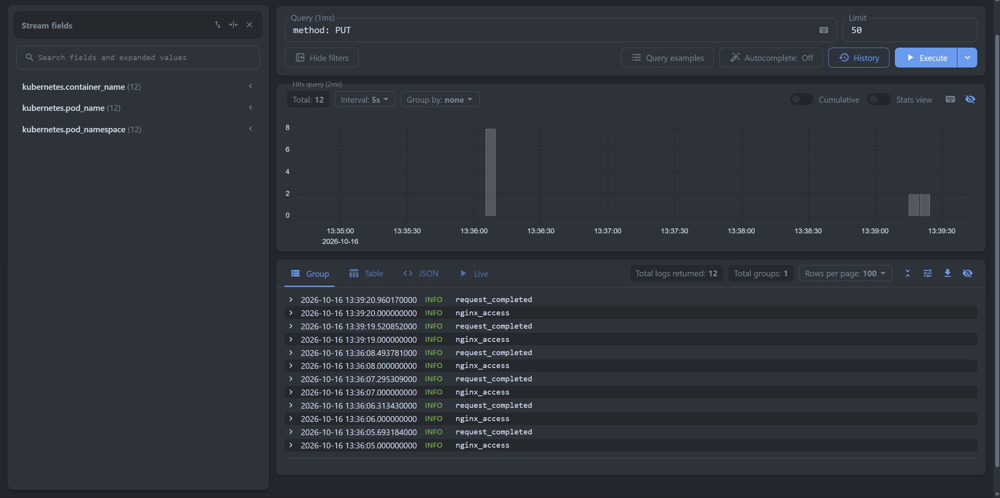
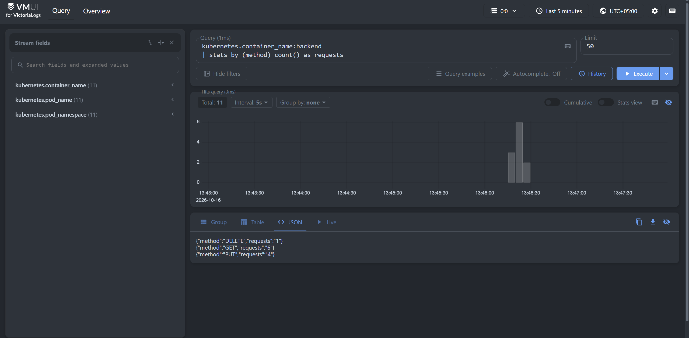
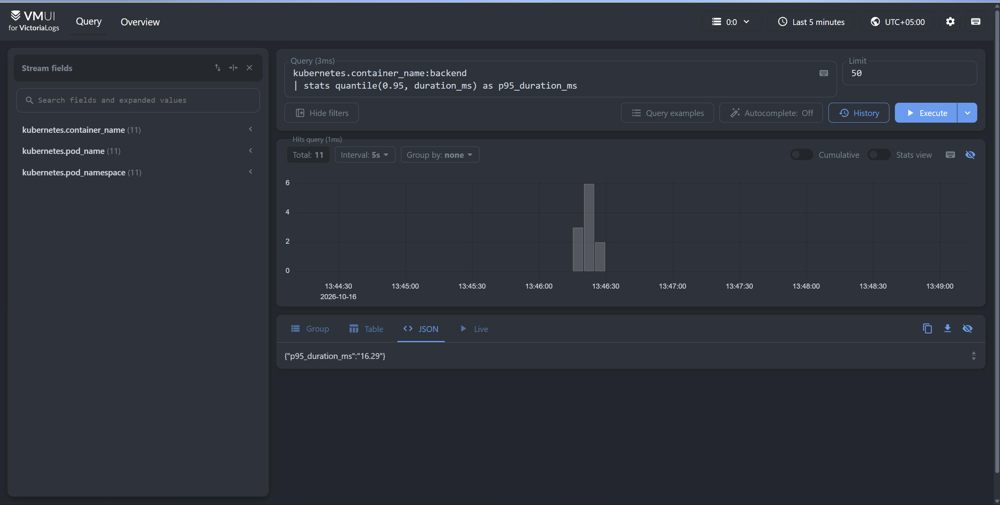
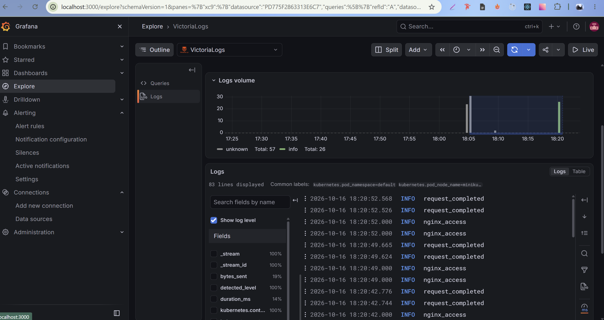

# Почему выбран victoria-logs-collector
Для доставки логов используется официальный `victoria-logs-collector`.

Он автоматически собирает логи контейнеров Kubernetes и отправляет их в Victoria Logs. При этом приложение просто пишет логи в `stdout`, и ему не нужно знать о системе логирования.

`victoria-logs-collector` выбран потому, что он напрямую интегрирован с Victoria Logs и требует меньше настройки, чем более универсальные Vector или Fluent Bit.

# LogsQL-запросы
## 1. Сырые записи за последние 5 минут
Скриншот `_hm3/img.png`

Запрос: `*`

Диапазон времени в vmui установлен в `Last 5 minutes`

Запрос показывает все записи, поступившие в Victoria Logs за выбранный период времени. 

## 2. Фильтр по конкретному полю
Скриншот `_hm3/img_1.png`

Запрос: `method: PUT`

Запрос фильтрует записи по полю method и оставляет только HTTP-запросы с методом `PUT`. Такой фильтр позволяет отдельно анализировать операции изменения задач.

## 3. Stats-запрос с группировкой
Скриншот `_hm3/img_2.png`

Запрос: `kubernetes.container_name:backend
| stats by (method) count() as requests`

Сначала выбираются только логи backend-контейнера. Затем записи группируются по HTTP-методу и для каждой группы подсчитывается количество запросов.

В результате можно увидеть распределение запросов по методам, например GET, PUT и DELETE.

## 4. Агрегирующий запрос
Скриншот `_hm3/img_3.png`

Запрос: `kubernetes.container_name:backend
| stats quantile(0.95, duration_ms) as p95_duration_ms`

Запрос вычисляет 95-й перцентиль времени обработки HTTP-запросов backend.
Поле duration_ms содержит длительность обработки запроса в миллисекундах. Значение p95 показывает время, быстрее которого выполняется примерно 95% запросов.

## Бонус: Grafana
Скриншот `_hm3/img_4.png`

Подключён официальный плагин `victoriametrics-logs-datasource`. Через него Victoria Logs используется как datasource в Grafana, а LogsQL-запросы можно выполнять в разделе `Explore`.