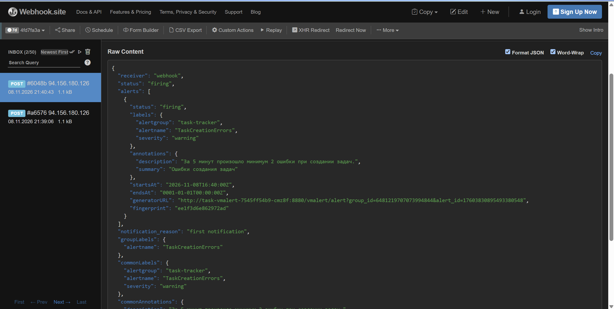
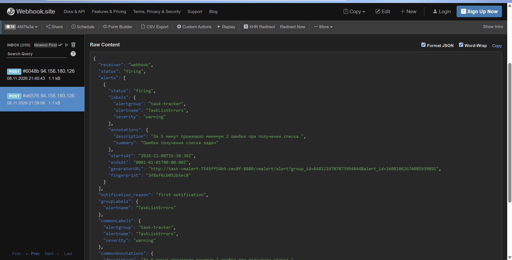
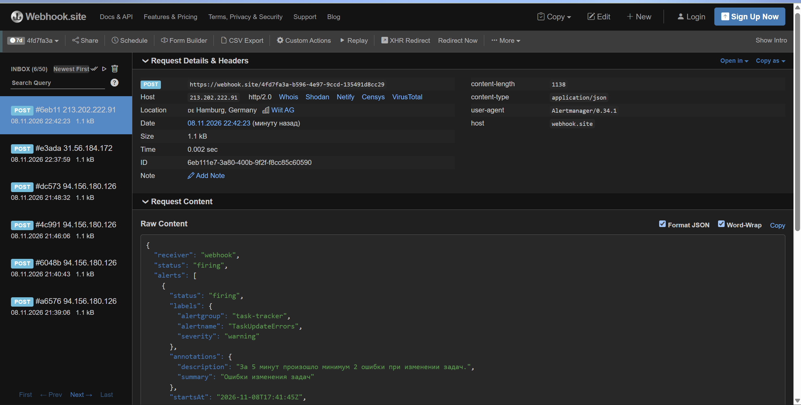
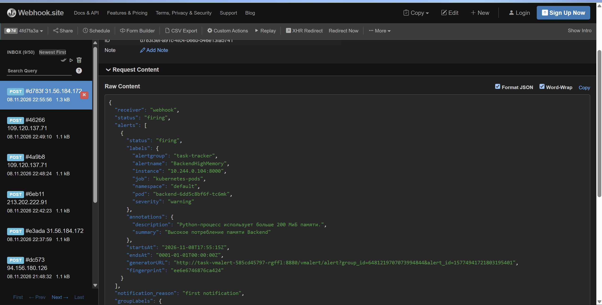
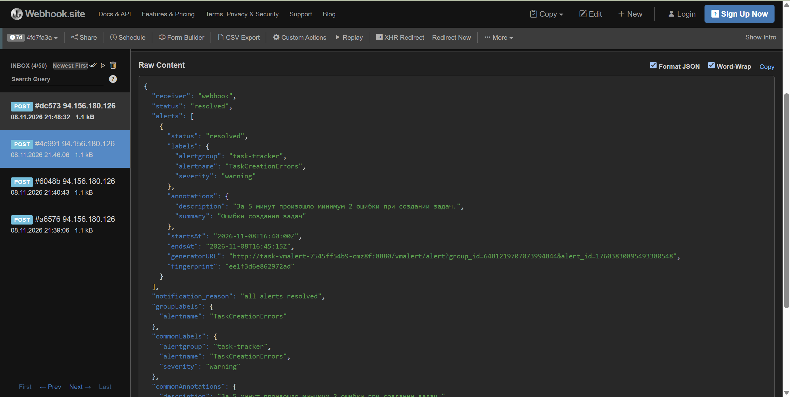
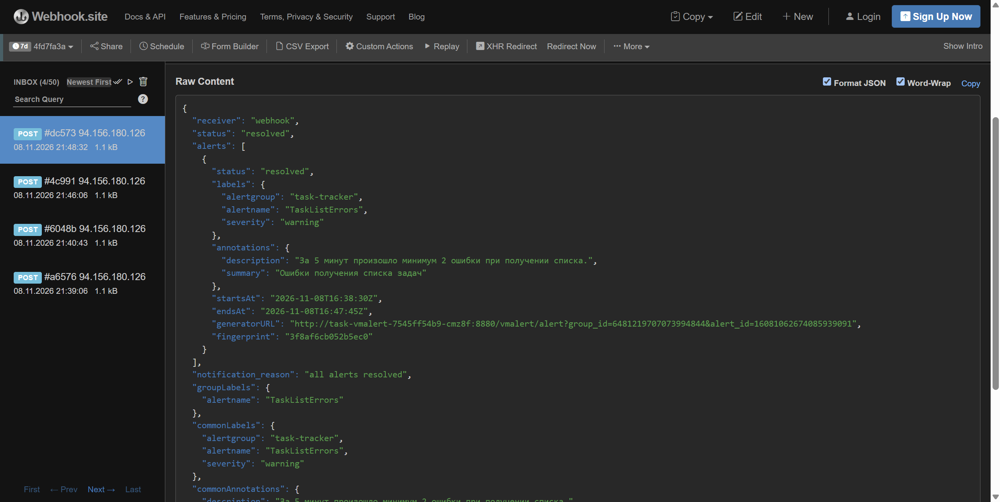
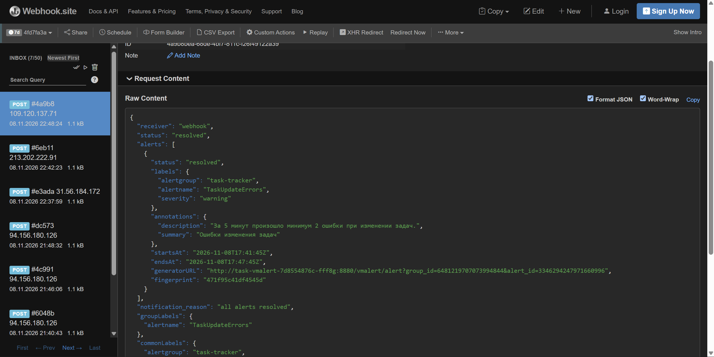
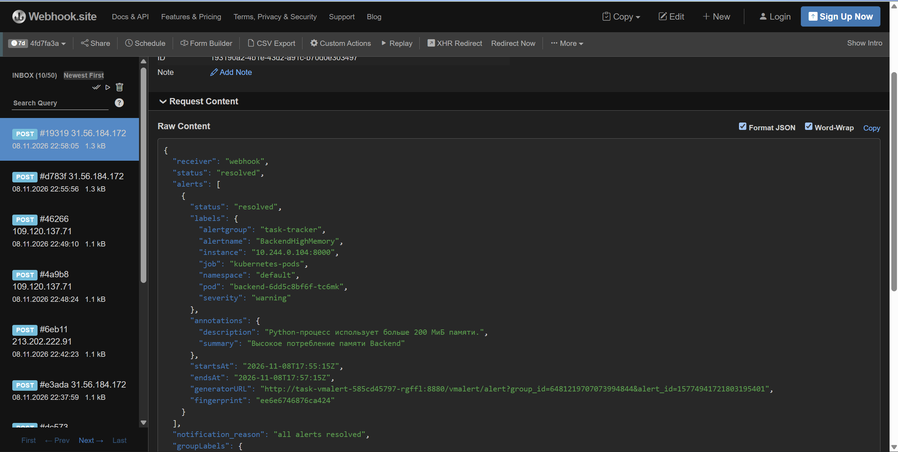

# Отчёт. Настройка алертов для Task Tracker

## 1. Выбранные алерты

Для мониторинга Task Tracker настроены алерты:

| Алерт                   | Условие срабатывания                                        | Назначение                                              |
|-------------------------|-------------------------------------------------------------|---------------------------------------------------------|
| `TaskListErrors`        | Не менее 2 HTTP 5xx при получении списка задач за 5 минут   | Контроль доступности основного сценария просмотра задач |
| `TaskCreationErrors`    | Не менее 2 HTTP 5xx при создании задач за 5 минут           | Обнаружение ошибок создания задач                       |
| `TaskUpdateErrors`      | Не менее 2 HTTP 5xx при изменении задач за 5 минут          | Обнаружение ошибок редактирования задач                 |
| `BackendHighMemory`     | Потребление памяти Backend более 200 МиБ в течение 1 минуты | Контроль использования памяти Python-процессом          |

Для сервисных алертов используются HTTP-метрики FastAPI с фильтрацией по маршруту и методу запроса, что позволяет контролировать отдельные пользовательские операции.

Для основных операций приложения выбраны алерты на HTTP 5xx, поскольку такие ошибки означают, что пользовательский сценарий завершается неуспешно. Порог в две ошибки за пять минут позволяет обнаруживать повторяющиеся сбои.
Затронуты операции: просмотр задач, создание задачи, изменение задачи (в том числе и выполнение задачи). Эти операции затрагивают основной сценарий: зайти на сайт, добавить задачу, выполнить задачу

Алерт на память позволяет обнаруживать повышенное потребление ресурсов Backend. Порог 200 МиБ выбран как учебное значение.

## 2. Реализация

Для проверки правил используется vmalert, установленный через Helm в namespace `monitoring`.

vmalert каждые 15 секунд выполняет запросы к Victoria Metrics Single. Если условие алерта выполняется в течение заданного времени, он отправляет уведомление в Alertmanager.

Alertmanager группирует алерты по `alertname` и отправляет уведомления через Webhook на сервис Webhook.site. Также включена отправка уведомлений при восстановлении нормального состояния (`send_resolved: true`). Telegram рассматривала в качестве способа доставки сообщений, но в текущей обстановке и блокировках на территории РФ решила сделать через webhook. 

Конфигурация правил и Alertmanager описана в файле `kubernetes/alerting/values.yaml` и секрете `kubernetes/alerting/alertmanager-secret.yaml`.

## 3. Проверка работы

Для проверки доставки уведомлений было вызвано тестовое срабатывание алерта с помощью `kubectl scale deployment/postgres --replicas=0`. После были отправлены HTTP запросы, которые получили код ответа 500. 
Для проверки памяти порог был временно снижен до 83886080 (80*1024*1024). Для проверки восстановления памяти команда `kubectl scale deployment/backend --replicas=0`

Алерты перешёл в состояние `firing`, после чего Alertmanager отправил HTTP POST на указанный Webhook URL.

Полученные уведомления отобразились в Webhook.site

Скриншоты находятся в `_hm6`

1. 
2. 
3. 
4. 
5. 
6. 
7. 
8. 

