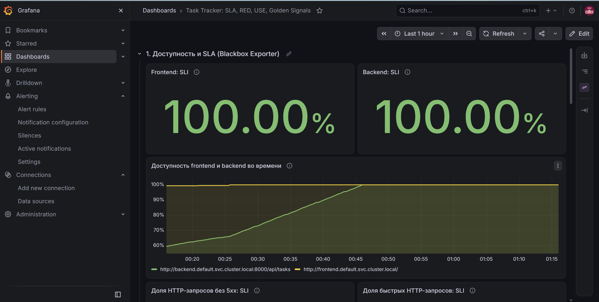
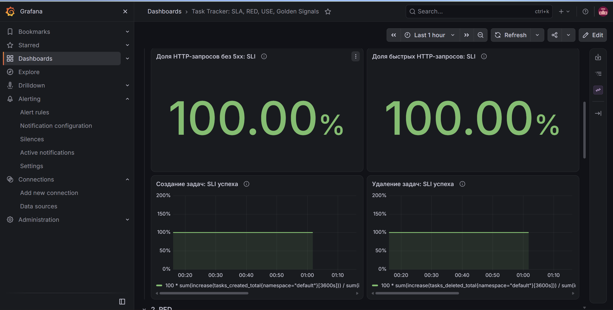
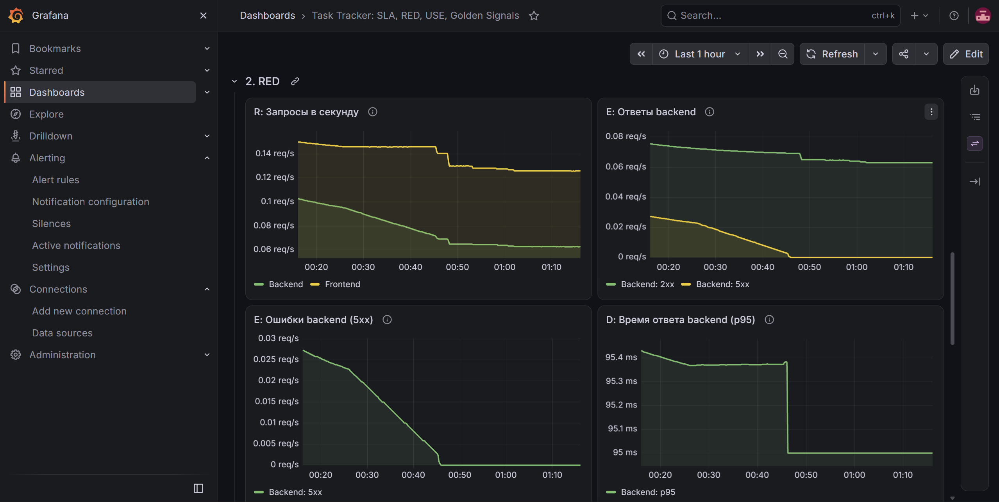
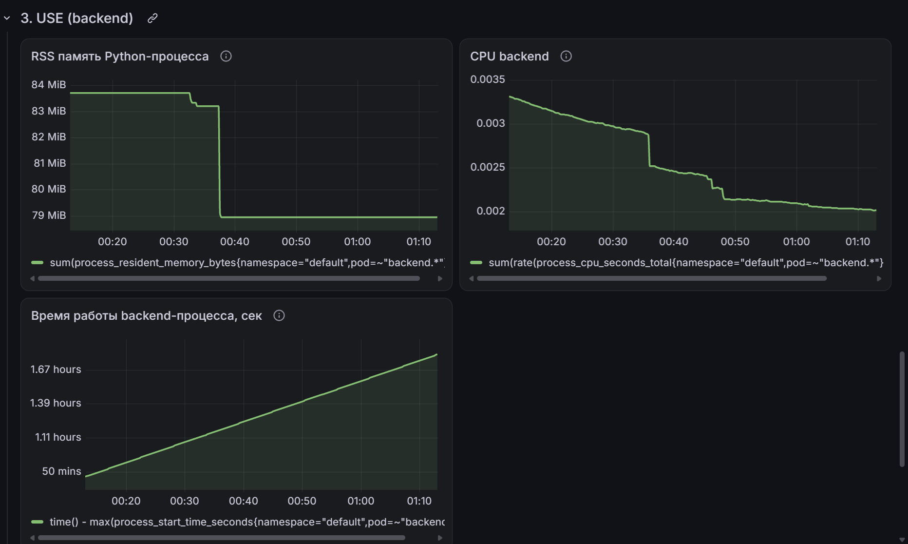
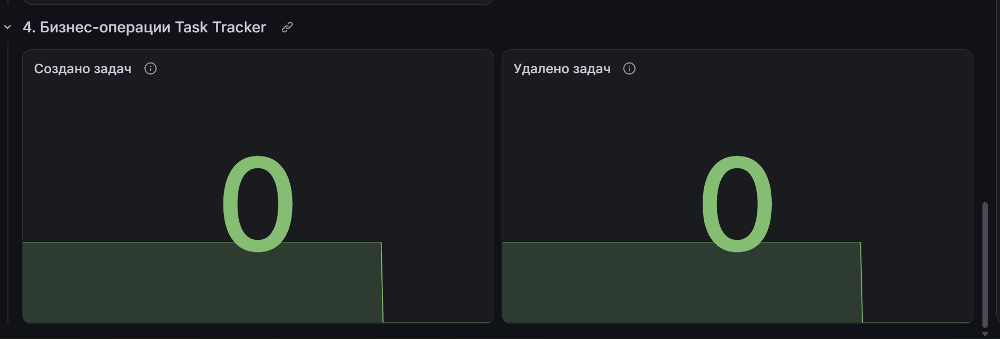
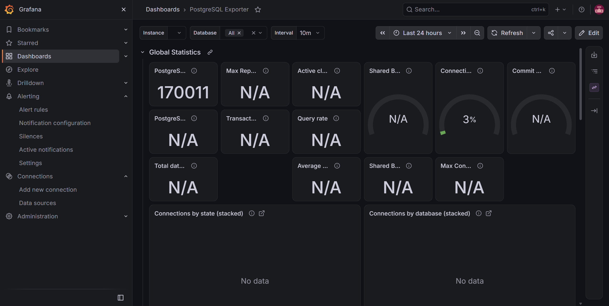
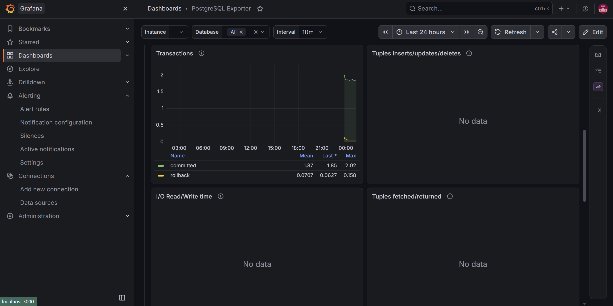
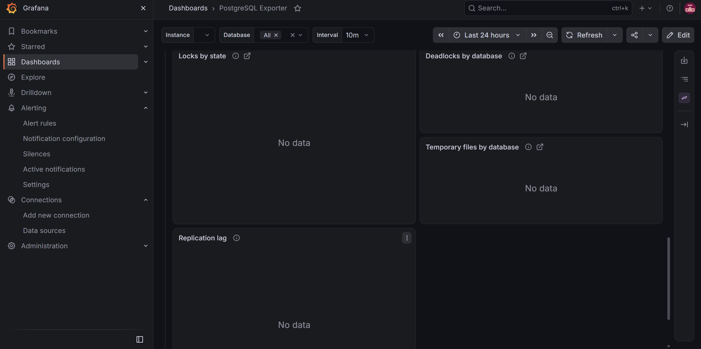
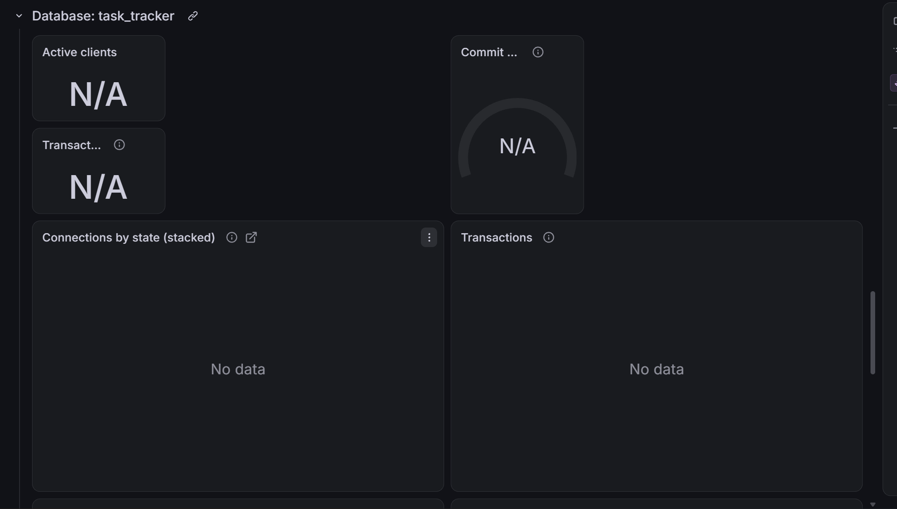

# Отчёт. Дашборды Grafana

## 1. Дашборд приложения Task Tracker

**Доступность и SLI/SLO/SLA**

Метрики взяты из `Отчет5.md`. Они прописаны как SLA, поэтому выведены вверх.

**RED (Rate, Errors, Duration)**

Выбраны следующие показатели:
- RPS frontend и backend - для оценки нагрузки.
- Распределение HTTP-ответов и ошибки 5xx - для обнаружения сбоев.
- p95 времени ответа backend - для оценки задержек.

Эти показатели также покрывают основные Golden Signals: Traffic, Errors и Latency.

**USE (Utilization, Saturation, Errors)**

Отображаются потребление памяти, CPU и время работы backend-процесса. Они позволяют оценивать использование ресурсов и замечать перезапуски приложения.

**Бизнес-метрики**

Добавлены счётчики созданных и удалённых задач для наблюдения за пользовательскими операциями.

## 2. PostgreSQL Exporter

Импортирован готовый дашборд PostgreSQL Exporter (ID `12485`). Скачала его, источник данных чуть поменяла на VictoriaMetrics.

Дашборд отображает метрики PostgreSQL: подключения, транзакции, использование буферов, блокировки и операции с данными.

## 3. Демонстрация

На скринкасте показаны дашборды Task Tracker и PostgreSQL Exporter, включая панели доступности, RED, USE, бизнес-метрики и показатели PostgreSQL.