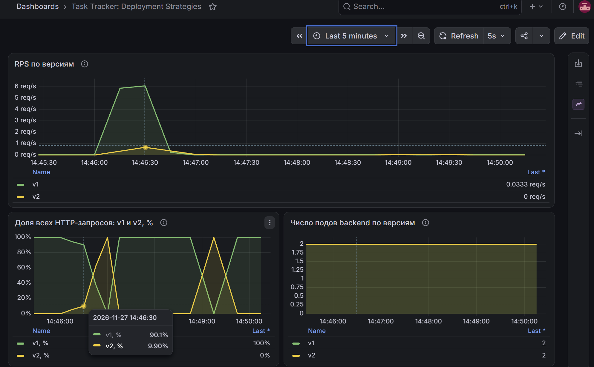

Переиспользованы манифесты из предыдущего домашнего задания по стратегиям деплоя.

В minikube развёрнуты две версии приложения Task Tracker (v1 и v2), по две реплики каждой версии. Для каждой версии создан отдельный ClusterIP Service.

Манифесты:
- kubernetes/strategies/apps/base
- kubernetes/strategies/apps/v1
- kubernetes/strategies/apps/v2

Для маршрутизации используется Envoy Gateway.
- kubernetes/strategies/gateway.yaml
- kubernetes/strategies/envoy-proxy.yaml
- kubernetes/strategies/routes/canary/90-10.yaml

С помощью скрипта [traffic.ps1](./kubernetes/strategies/traffic.ps1) отправлено 200 HTTP-запросов на эндпоинт /version через Gateway.

Логи запросов:
- [Полные логи запросов](_hm9/responses.txt)
- 

Фактическое распределение 200 тестовых запросов полностью соответствует заданным весам 90/10.
Вне периода тестирования на графике наблюдаются резкие
изменения долей трафика, обусловленные периодическими
автоматическими запросами при отсутствии основной нагрузки.

| Версия | Количество ответов | Фактическая доля |
|--------|--------------------|------------------|
| v1     | 180                | 90%              |
| v2     | 20                 | 10%              |
| Всего  | 200                | 100%             |